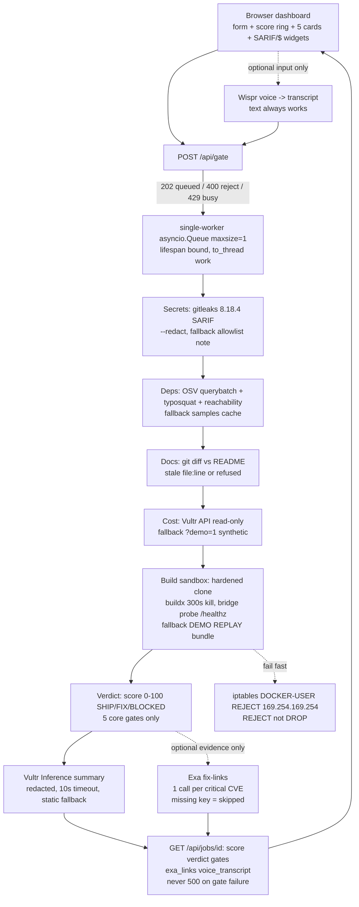

# BatonGate architecture

> NOTE: export a screenshot of the live dashboard to `docs/architecture.png` on the Vultr VM
> (after a real gate run, desktop viewport). This mermaid diagram is the source of truth until then.

Never-500 rule: gate failure returns `status done` with `verdict FIX/BLOCKED` + evidence; only malformed requests return 4xx. Exa / Wispr / Inference never change the verdict.
